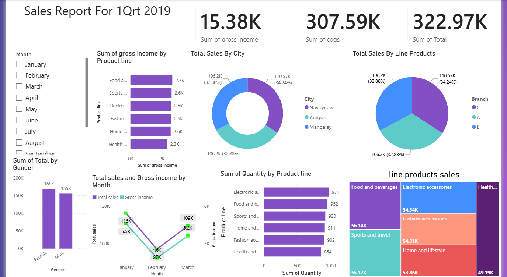

# 🛒 Supermarket Sales Power BI Dashboard

Welcome to the Supermarket Sales Analytics project! This dashboard provides deep insights into retail performance, sales trends, and profitability.

## 📊 Dashboard Preview

## 📌 Project Overview
- **Objective:** Analyze supermarket branch sales data to uncover key performance indicators (KPIs), profit margins, and customer purchasing patterns.
- **Tools Used:** Power BI, DAX, Excel.
- **Key Metrics Tracked:**
  - Total Sales & Gross Income
  - Cost of Goods Sold (COGS)
  - Sales by City & Product Line
  - Monthly Sales Trends

## 📂 Files in this Repository
- `supermarket sales.pbix`: The original Power BI interactive dashboard file.
- `Dashboard.png`: Visual preview of the dashboard.
